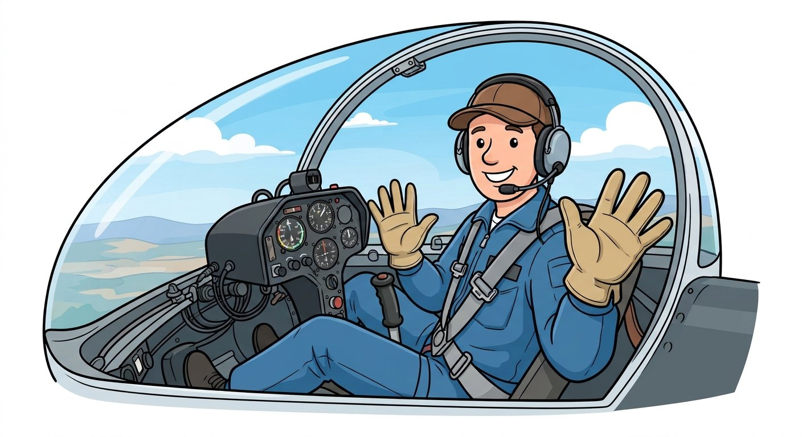

# Condor 3 VR Hand Cockpit



Fly Condor 3 in VR with your **bare hands** or Quest controllers on the cockpit controls.

Your hands are invisible in Condor, so feedback is by **sound**: a voice names the control
your hand reaches. Pinch to grab it, move your hand, open your fingers to let go. Condor's
lever follows.

Condor is not modified. `condorhands.exe` runs next to it and drives a vJoy virtual joystick.

> Not affiliated with or endorsed by Condor Soaring or Meta. "Condor" and "Quest" are used
> only to describe compatibility.

## Gliders

| Glider                        | Profile      | Controls besides stick and airbrake              |
|-------------------------------|--------------|--------------------------------------------------|
| Lange Antares 18S             | `Antares18S` | flaps, trim, gear switch, ballast switch, release |
| Schleicher ASW 28-15          | `ASW28-15`   | trim, gear lever, ballast lever, release         |
| Schempp-Hirth Duo Discus      | `DuoDiscus`  | trim, gear lever, ballast lever, release         |
| Schempp-Hirth Standard Cirrus | `StdCirrus`  | trim, gear lever, release                        |
| Diana 2                       | `Diana2`     | flaps, trim, gear lever, ballast lever, release  |
| Genesis 2                     | `Genesis2`   | trim, gear lever, ballast lever, release         |
| Blanik                        | `Blanik`     | flaps, trim, release                             |
| Grunau Baby                   | `GrunauBaby` | release                                          |

Each control is used by the hand that works it in the real glider. The stick takes either
hand, except on the Diana 2 (right only).

## Requirements

* Meta Quest over Link (cable or Air Link), hand tracking on.
* Condor 3 with *Setup → Setup VR → VR API: Oculus*.
* [vJoy](https://github.com/njz3/vJoy), device 1 with axes X, Y, Z, RX, RY, RZ and 3 buttons
  (the default configuration).

## Setup

`condorhands.exe` has no window: it runs in a terminal. After the [build](#build), it is in
the repository's `build\app\RelWithDebInfo` folder, with the `profiles` folder next to it.
Open PowerShell (Start menu → *Windows PowerShell*), go to that folder, and run it with `.\`
in front:

```powershell
cd C:\path\to\condor3VRCockpit\build\app\RelWithDebInfo
.\condorhands.exe run
```

Replace `C:\path\to\condor3VRCockpit` with where you cloned the repository. Below,
`condorhands run` means `.\condorhands.exe run` typed in that folder. Without a glider name,
the gliders are listed and you choose one by number. Stop it with **Ctrl+C**.

**1. Assign the controls in Condor** (once). Run `condorhands bind Antares18S`, which has
every output. Press a number; 5 s later that output moves, so Condor's *Setup → Input*
detects it.

| vJoy     | Condor function            |
|----------|----------------------------|
| axis RY  | elevator                   |
| axis RX  | ailerons                   |
| axis RZ  | rudder (controllers only)  |
| axis X   | airbrakes                  |
| axis Y   | flaps                      |
| axis Z   | trim                       |
| button 1 | tow release                |
| button 2 | landing gear               |
| button 3 | water ballast dump         |

For axis trim on gliders with stick trim (Antares), untick *Stick trim where available*.

**2. Calibrate each glider.** In its cockpit, run `condorhands calibrate`. To redo one
control: `condorhands calibrate Antares18S flaps`. For each position the voice asks for:
1. Condor's control moves there by itself.
2. Turn one palm towards you and put its Meta icon on the handle.
3. Pinch with the **other** hand for half a second, palm not facing you (no Meta icon on
   it). A click confirms.

If Condor's control is not exactly at the named position, adjust it first with **Up/Down**
(fine) or **PgUp/PgDn** (coarse). Condor does not receive these keys.

**3. Fly.** Run `condorhands run`. With rudder pedals, add `--no-rudder` and don't assign RZ.

## Flying

| Control       | How                                                                    |
|---------------|------------------------------------------------------------------------|
| Stick         | Pinch the grip and move it. Back to centre when you let go.            |
| Airbrake      | Move the handle. Position said every 10 % ("brakes 30"), and every 8 s while open. |
| Flaps         | Move the lever. Each notch is said.                                    |
| Trim          | Move the lever. A tick every 5 %, a double beep at the centre.         |
| Gear          | Switch: pinch it. Lever: move it across. "Gear" or "gear lever" is said. |
| Water ballast | Pinch the switch, or move the lever across.                            |
| Tow release   | Pinch the handle. Released while you pinch.                            |

* A low buzz: end of travel.
* Pinch with the palm **not facing you**: a hand showing the Meta icon opens the Meta menu,
  and the program ignores its pinch.
* Two-position levers: grab them where Condor shows them. If the program thought they were
  at the other end (gear up after a start in flight), it follows without pressing anything.
* Recenter the view from your normal seated position; the calibration stays valid.

**Controllers:** pick them up any time ("controllers"), put them down for hands ("hands").
* Squeeze the **grip** instead of pinching.
* Stick: put a controller on it and squeeze. Move it for pitch and bank, twist it for rudder.
* **A** button: Condor's autorudder on/off (sends the **A** key). Twisting is ignored while on.

`condorhands monitor` shows live tracking data.

## Profiles

Templates are in `profiles\`. On first use a glider's profile is copied to
`%LOCALAPPDATA%\condor3VRCockpit\profiles\`, where calibration is saved. Useful settings:

| Setting                 | Effect                                                     |
|-------------------------|------------------------------------------------------------|
| `zoneRadius`            | Distance (m) at which your hand reaches a control.         |
| `pinchGrab`, `pinchRelease` | Pinch (or grip) strength to grab and to let go.        |
| `controllerStickTravel` | Controller movement (m) for full stick (0.10).             |
| `controllerRudderAngle` | Controller twist (degrees) for full rudder (30).           |
| `autorudderKey`, `autorudderOn` | Condor's autorudder key; its state at start.       |
| `hand`                  | Per control: `left`, `right` or `any`.                     |
| `vjoyRange`             | vJoy values at the two ends of a lever; swap to reverse.   |
| `feedback`              | Per lever: `announce`, `ticks` or `none`.                  |
| `announce`, `announceEnds`, `announceEvery` | Words and reminder interval for `announce`. |

To add a glider, copy a similar profile, adapt the controls, and calibrate.

## How it works

Condor 3 uses the Oculus PC SDK (LibOVR), which has no public hand tracking. The Meta runtime
exports an undocumented function that returns each hand's position and pinch over Link;
`condorhands` reads it from its own invisible session next to Condor
([notes](docs/hand-tracking-notes.md)). Controllers are read through the public SDK. A Meta
runtime update could break hand reading.

## Build

Visual Studio 2026 with C++, 32-bit like Condor:

```powershell
cmake --preset win32
cmake --build --preset release
```

Output: `build\app\RelWithDebInfo\condorhands.exe` with the profiles. `scripts\build.ps1`
rebuilds even while it runs.

## Repository

```
app/             condorhands source
profiles/        glider profile templates
docs/            notes on the Meta runtime functions used, README image
tools/ovrprobe/  probes used to find the hand data
layer/           OpenXR layer prototype (unused; Condor has no OpenXR)
scripts/         build script, layer install scripts
```

## License

[MIT](LICENSE). Third-party components: [THIRD_PARTY_NOTICES.md](THIRD_PARTY_NOTICES.md).
